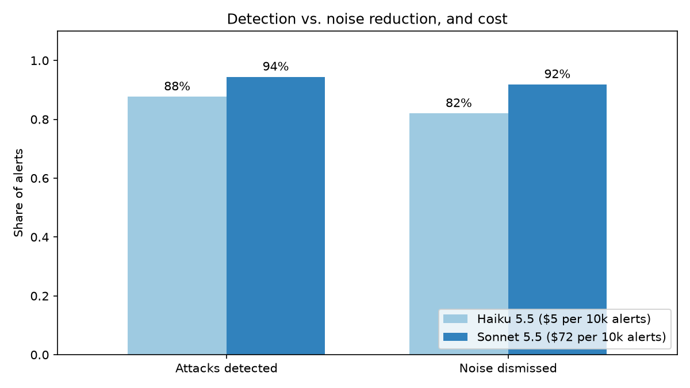
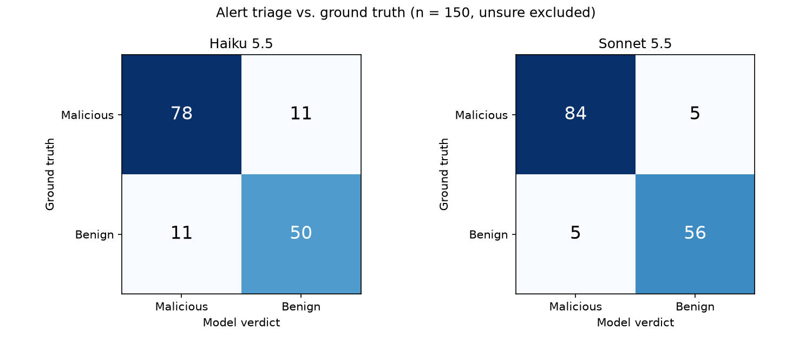
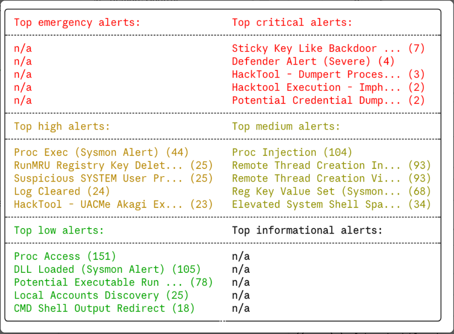

# AI-Assisted SOC Alert Triage with Claude

Can a large language model triage SIEM alerts like a SOC analyst: escalate real attacks and safely dismiss false positives?

This project runs real Windows attack logs and clean baseline logs through 4,500+ Sigma rules, then asks Claude to triage each alert with a structured verdict, severity, MITRE ATT&CK mapping and next steps. The answers are evaluated against a labelled ground truth.

## Key results

| | Claude Haiku 5.5 | Claude Sonnet 5.5 |
|---|---|---|
| Attacks detected (recall) | 88% (78/89) | **94%** (84/89) |
| Attacks missed | 11 | **5** |
| False positives dismissed | 82% (50/61) | **92%** (56/61) |
| Precision | 88% | **94%** |
| Correct ATT&CK tactic | 65% | 68% |
| Time per alert | 4.8 s | 5.1 s |
| Cost per 10,000 alerts | **$5** | $72 |

Sonnet is better on every quality metric, but costs about 14x more. Haiku already dismisses 82% of false positives for roughly $5 per 10,000 alerts.

## The problem

A single clean Windows 10 machine produced **47,935 alerts in two days**, none of them malicious. 278 small attack recordings produced another **2,121 alerts**. Most come from broad rules such as *Proc Access* and *Proc Injection*, and the rule level says little about the real risk: a `low` alert can be an actual DLL side-loading attack, and a `high` alert named "HackTool" can be a software installer.

## Pipeline

1. **Logs:** Windows event logs from attack simulations ([EVTX-ATTACK-SAMPLES](https://github.com/sbousseaden/EVTX-ATTACK-SAMPLES)) and from a clean Windows 10 client ([Nextron evtx-baseline](https://github.com/NextronSystems/evtx-baseline)).
2. **Detection:** [Hayabusa](https://github.com/Yamato-Security/hayabusa) v4.2.0 with Sigma rules (level `low` and above) turns the logs into alerts.
3. **Evaluation set:** 100 unique alerts sampled from the attack logs, stratified by ATT&CK tactic, plus one alert per rule from the clean baseline (57 alerts). 157 alerts in total.
4. **Triage:** Each alert is sent to Claude with a SOC-analyst system prompt and a fixed output schema (structured outputs): verdict, confidence, severity, ATT&CK tactic and technique, summary and next steps.
5. **Evaluation:** Verdicts are compared with the ground truth, and token usage is converted to cost.

## Method

**No leakage.** Fields that reveal the answer (log file name, tactic folder, alert ID, rule file and timestamp) are removed before an alert is sent to the model. Claude only sees what an analyst would see in the alert itself.

**Ground truth.**
- *Baseline alerts (57):* labelled benign, since the machine is a known-clean baseline.
- *Attack-dataset alerts (100):* not every alert in an attack recording is part of the attack, so each alert was labelled malicious, benign or unsure. Labels were proposed with written reasoning by an LLM (Claude Opus) and reviewed by me alert by alert. Result: 89 malicious, 4 benign, 7 unsure.
- The 7 *unsure* alerts (mostly cleared event logs, which in this dataset can be either attacker activity or lab setup) are excluded from the metrics and reported separately.

## Findings

**1. The missed attacks look normal on their own.** Both models missed `net start CDPSvc`, pass-the-hash logons (logon type 9 via `seclogo`) and the RemoteRegistry service starting. Each event is ordinary in isolation and only malicious in context, for example a service restart that loads a hijacked DLL. Triaging one alert at a time is the main limitation, and adding surrounding events to the prompt is the most promising improvement.

**2. Many "false escalations" are defensible.** Several benign alerts flagged as malicious were unknown executables running from a Temp folder (installers on the baseline machine) or a cleared Sysmon log. A cautious human analyst would also check these.

**3. Answers are not deterministic.** In a single test, Haiku labelled the "HackTool - SysmonEnte Execution" alert benign. In the full run, it labelled the same alert malicious with high confidence. Results should always be measured over many alerts, not single examples.

**4. Self-reported confidence is a weak signal.** Most errors had `medium` confidence, but at least one was `high`.

**5. ATT&CK tactics are ambiguous.** RDP tunnelling with plink can reasonably be mapped to *Command and Control* (T1572) or *Lateral Movement* (T1021.001). Tactic accuracy (65-68%) should be read with this in mind.

## Limitations

- **Ground truth:** one reviewer, with AI-proposed labels for the attack alerts. Since the labels were drafted by a Claude model, agreement with Claude may be overestimated.
- **Small and synthetic data:** 157 alerts from lab recordings. Real environments have far more noise and more varied software.
- **Class balance:** malicious alerts are over-represented compared with a real SOC, where most alerts are false positives.
- **Some tactics are thin:** Discovery and Command and Control have only two alerts each.
- **Single run:** each model was run once. Repeated runs would show how much the results vary.

## Tech stack

Python, pandas, matplotlib, Anthropic Python SDK (structured outputs), Hayabusa, Sigma

## Data and licences

The attack logs ([EVTX-ATTACK-SAMPLES](https://github.com/sbousseaden/EVTX-ATTACK-SAMPLES), GPL-3.0) and baseline logs ([evtx-baseline](https://github.com/NextronSystems/evtx-baseline), Apache-2.0) are not redistributed in this repository. Hayabusa and its rules are downloaded separately.
